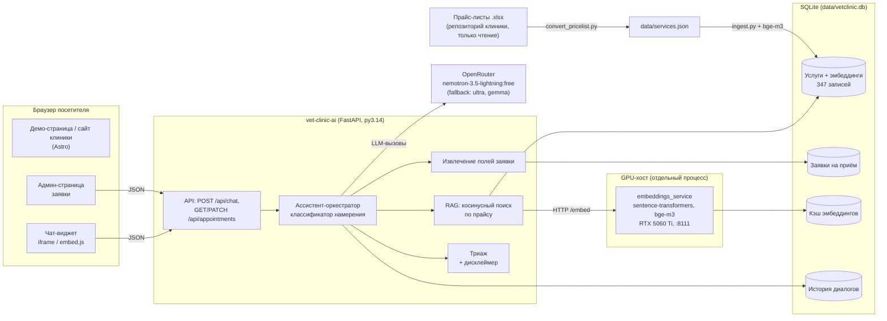
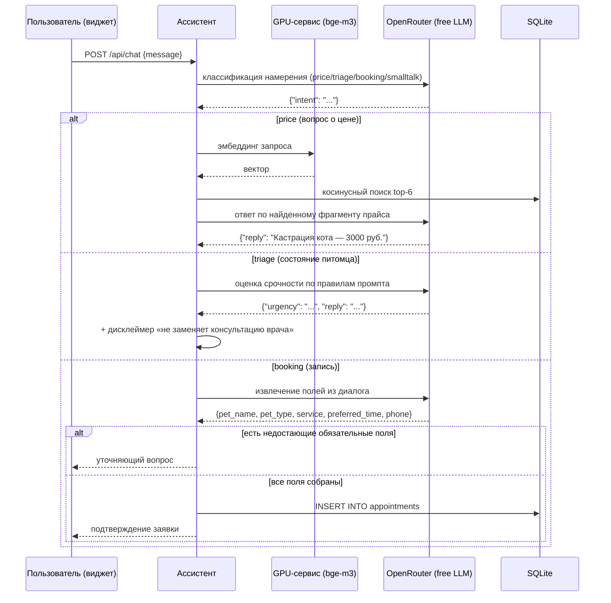

# Архитектура

Демо-стенд AI-ассистента для сайта ветклиники kashtanka64.ru (сам сайт —
отдельный продовый проект на Kotlin/Quarkus + Astro + k8s, сюда не входит).

## Общая схема

## Поток обработки сообщения

## Ключевые решения

| Решение | Почему |
|---|---|
| SQLite + косинус в Python | 347 векторов × 1024 измерения: полный перебор — единицы мс; pgvector добавил бы инфраструктуру без выгоды. Интерфейс `search()` позволяет перейти позже без изменений вызывающего кода |
| Эмбеддинги отдельным GPU-процессом | bge-m3 на RTX 5060 Ti в собственном venv (py3.12 + torch), приложение (py3.14) ходит по HTTP. Нет GPU-passthrough в контейнеры, нет тяжёлых зависимостей в сервисе |
| Кэш эмбеддингов в SQLite | повторный ингест бесплатен; смена модели = новая запись по имени модели, старые кэши не мешают |
| LLM только OpenRouter free | без затрат на демо; цепочка fallback `LLM_MODELS`; GLM убран из цепочки, reasoning-модели требуют max_tokens ~2500 |
| Категории правилами, не LLM | детерминированность и покрытие тестами; данные для правил — категории с реального сайта |
| История диалога в SQLite | многходовая запись переживает перезапуск процесса; «незавершённая запись» определяется по intent=booking без созданной заявки |

## Ограничения демо

- Одно SQLite-соединение с lock — достаточно для демо, для продажи —
  пул/Postgres.
- Классификация намерения — отдельный LLM-вызов: +2–10 с на реплику на
  бесплатной reasoning-модели. В проде можно урезать до маленькой модели
  или локального классификатора.
- Админка без авторизации (закрывается на уровне ingress в реальном
  встраивании).
